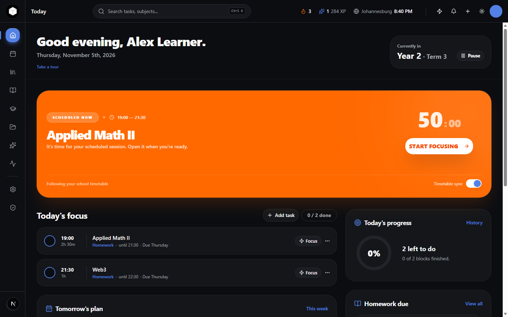
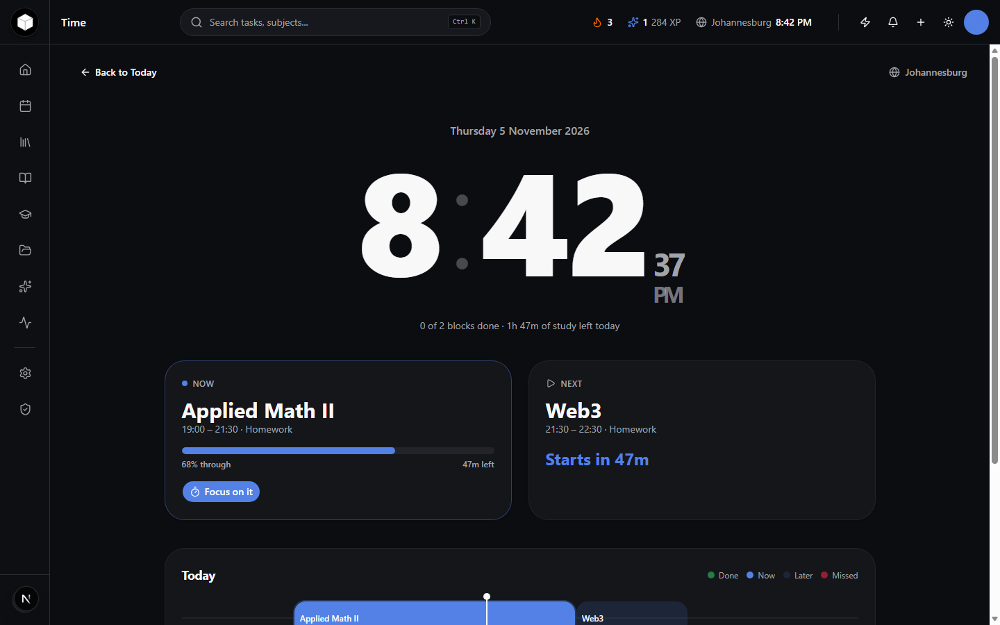
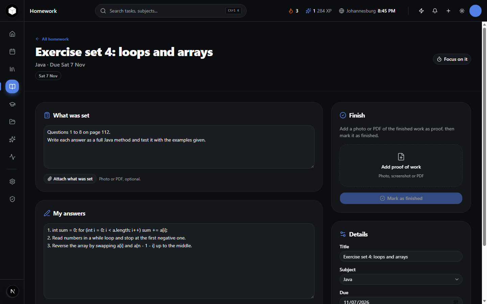
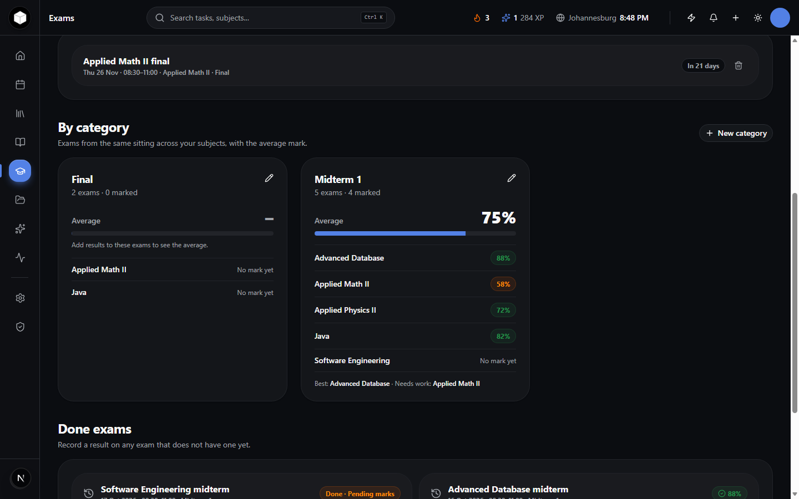
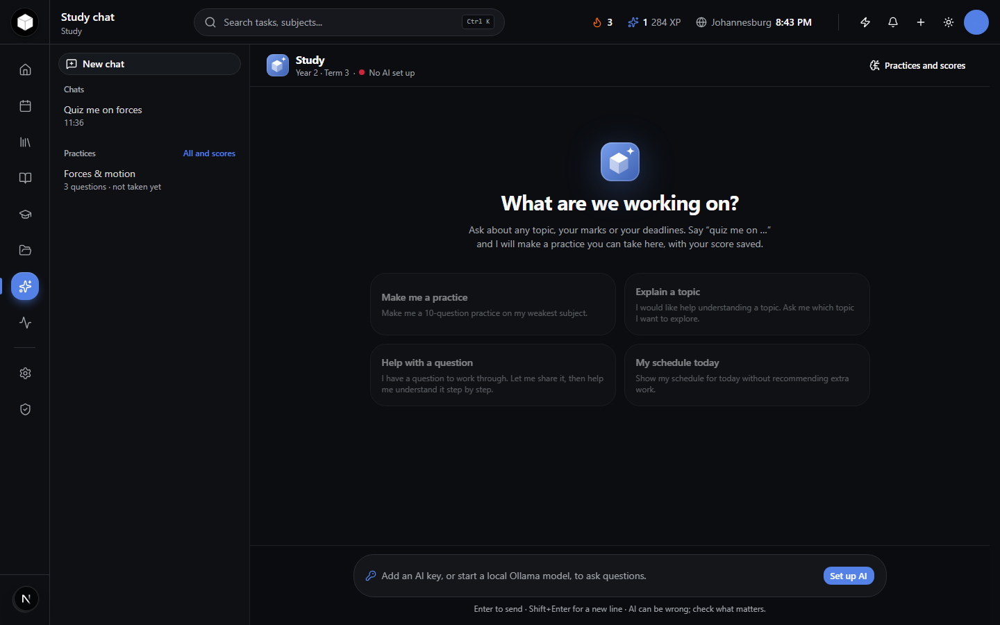
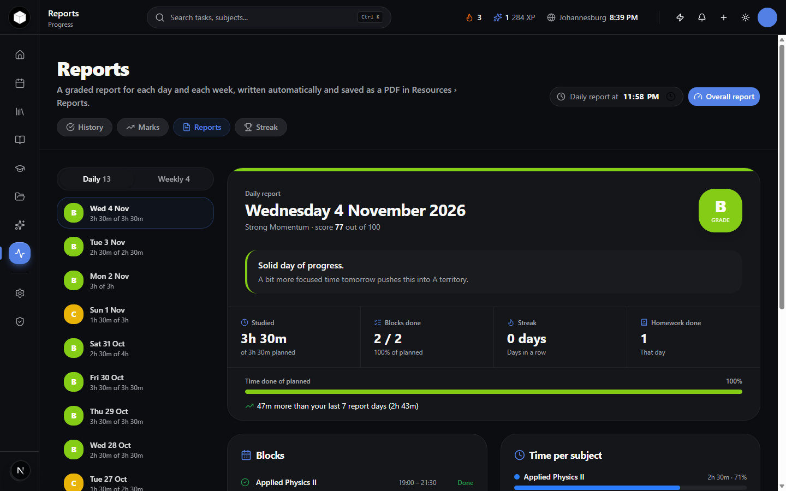
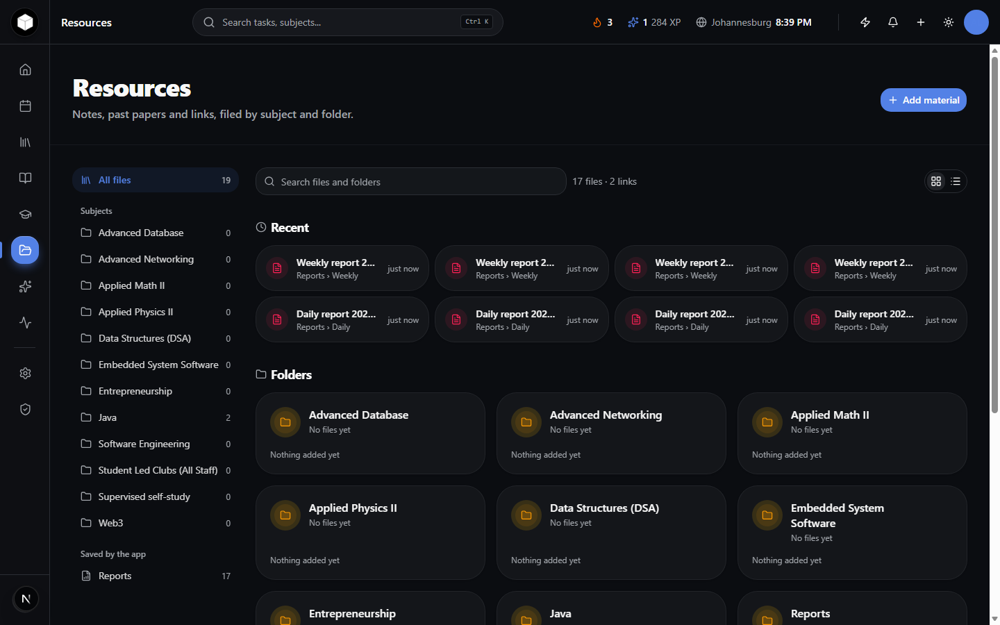
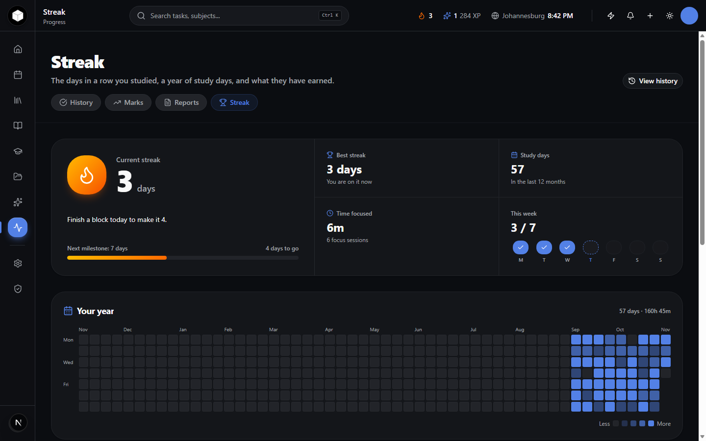

<div align="center">


# Study Flow

**Your school week, your study plan and your results, in one place.**

[](https://github.com/leviGatimu/study-flow-app/releases/latest)
[](https://studyingflow.vercel.app)



</div>

## What is it?

Study Flow is a study planner for students. You tell it your timetable and when you want to study, and every
day it shows you what to do next. You tick blocks off as you finish them, keep your homework, exams and
notes per subject, and see honestly how your week went.

It works in the browser and as a Windows app that also works offline. Both stay in sync.

## What you can do

<table>
<tr>
<td width="50%" valign="top">

### Know what to do today
The home page shows the block you should be on now, the rest of today, tomorrow, and what homework and exams are close.

</td>
<td width="50%" valign="top">

### See the time at a glance
A big clock with what is on now, how long is left, what comes next, and today laid out on one line.

</td>
</tr>
<tr>
<td></td>
<td></td>
</tr>
<tr>
<td valign="top">

### Do your homework in one place
Each homework has its own page: write down what was set, write your answers, attach photos, and mark it finished with proof.

</td>
<td valign="top">

### Keep track of exams
Count down to every exam, plan revision back from its date, record your mark, and group exams like "Midterm 1" to see your average across subjects.

</td>
</tr>
<tr>
<td></td>
<td></td>
</tr>
<tr>
<td valign="top">

### Study with the AI
Ask about any topic, your marks or your deadlines. Say "quiz me on photosynthesis" and it makes a practice you can take, with your score saved.

</td>
<td valign="top">

### Get a report every day and week
A grade, time studied against planned, every block done or missed, time per subject, and what to do next. Each report is saved as a PDF.

</td>
</tr>
<tr>
<td></td>
<td></td>
</tr>
<tr>
<td valign="top">

### Keep your files organised
Notes, past papers and links in a folder per subject, with search across everything. On Windows the folders are real folders on your computer.

</td>
<td valign="top">

### Build a streak
Your days in a row, the next milestone, and a full year of study days, darker for the days you studied longer.

</td>
</tr>
<tr>
<td></td>
<td></td>
</tr>
</table>

Also inside: a full-screen focus mode with your own music, a week and month calendar, your school
timetable read from a photo, marks and report cards, light and dark themes, and a choice of main colour.

## Get it

- **Windows:** [download the installer](https://github.com/leviGatimu/study-flow-app/releases/latest). It updates itself.
- **Browser:** [studyingflow.vercel.app](https://studyingflow.vercel.app).

Sign in with the same account on both and your work syncs between them. The AI needs a key (a Google Gemini
key is free) or a local [Ollama](https://ollama.com) model; everything else works without one.

---

## For developers

Next.js 16 (App Router, server actions), React 19, Tailwind 4, Prisma 5. Postgres (Supabase) for the
website, SQLite for the Windows app (Electron), with a sync engine between them.

### Run the website locally

Requires Node 20+ and a Postgres database.

```bash
git clone git@github.com:leviGatimu/study-flow-app.git
cd study-flow-app
npm install
cp .env.example .env      # fill it in, see below
npx prisma migrate deploy
npm run dev               # http://localhost:3000
```

| Variable | Required | Notes |
|---|---|---|
| `DATABASE_URL` | yes | Supabase session pooler, port `5432` (faster than the transaction pooler here; see `lib/prisma.ts` for the connection cap) |
| `DIRECT_URL` | yes | Same pooler; used for migrations |
| `JWT_SECRET` | yes | Signs the sign-in cookie. `node -e "console.log(require('crypto').randomBytes(48).toString('base64url'))"` |
| `SUPABASE_URL`, `SUPABASE_SERVICE_ROLE_KEY`, `SUPABASE_STORAGE_BUCKET` | on Vercel | Upload storage. Without them uploads go to `public/uploads`, which is fine locally and lost on every Vercel deploy |

### Database changes

`prisma/schema.prisma` (Postgres) is the source of truth; `scripts/prisma-sqlite.mjs` derives the SQLite
schema. Every change needs a migration in both `prisma/migrations` and `prisma/migrations-sqlite`. The
Windows app applies its own migrations when it starts. For the website:

```bash
npm run db:migrate:web -- --env=path/to/.env            # shows what is pending
npm run db:migrate:web -- --env=path/to/.env --apply    # applies it
```

Apply before deploying code that needs the change. When a new column must reach older Windows apps
safely, add it to the pull filters in `lib/sync/protocol.ts`.

### Build the Windows app

```bash
JWT_SECRET=<any-throwaway-value> npm run build:desktop   # never put it in a .env file: it would ship
cd desktop-app
npm run dist                                             # -> desktop-app/dist/StudyTrackerSetup.exe
```

Stop any running dev server first; it holds the Prisma engine file and the build fails. The build puts the
web Prisma client back on Postgres when it finishes. Releases are published on GitHub with
`StudyTrackerSetup.exe` and `latest.yml`, which the app's updater reads.

### Scripts

| Command | What it does |
|---|---|
| `npm run dev` | Dev server |
| `npm run build` | Website production build |
| `npm run build:desktop` | Windows app bundle |
| `npm run db:postgres` / `db:sqlite` | Switch the generated Prisma client |
| `npm run db:migrate:web` | Show or apply pending website migrations |
| `npm run test:sync` | All tests (run `test:sync:setup` once after a schema change) |

### Project layout

```
app/            pages and server actions
components/     UI
lib/            app logic: auth, AI, reports, sync, uploads, XP
lib/sync/       desktop <-> website sync (merge rules, wire format, file transfer)
prisma/         schemas and migrations for both databases
desktop-app/    Electron app and installer config
test/           node:test suites, including multi-database sync tests
docs/           UI rules (docs/ui-contract.md) and images
```

UI work follows [`docs/ui-contract.md`](docs/ui-contract.md) and uses plain wording.

---

<div align="center">
<sub>Built by <a href="https://github.com/leviGatimu">leviGatimu</a>.</sub>
</div>
